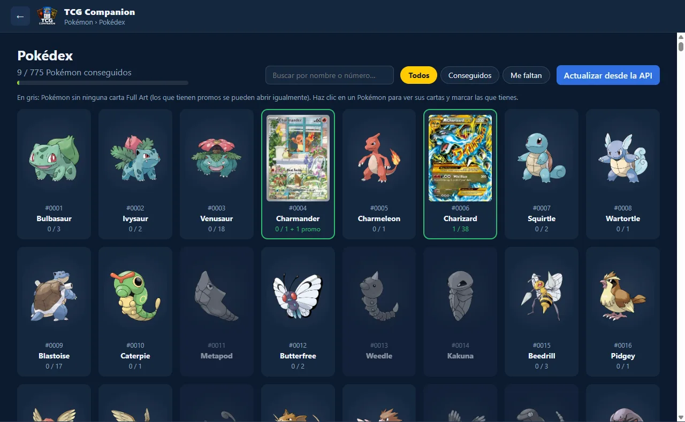
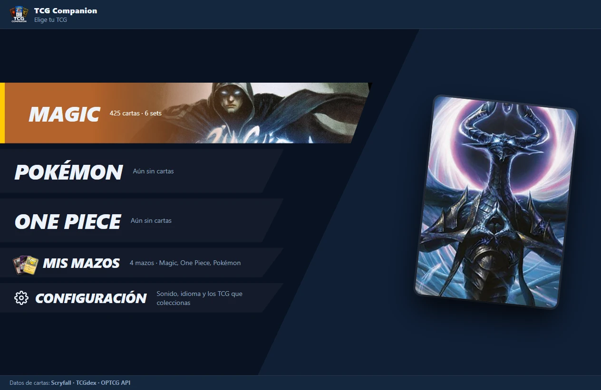
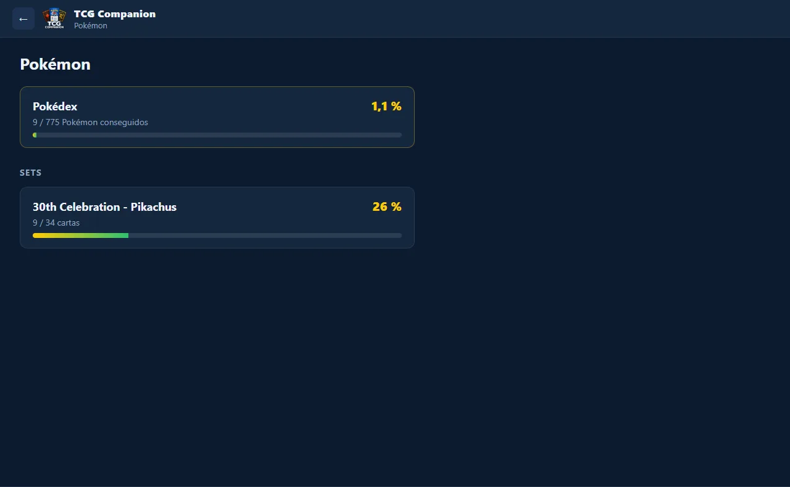
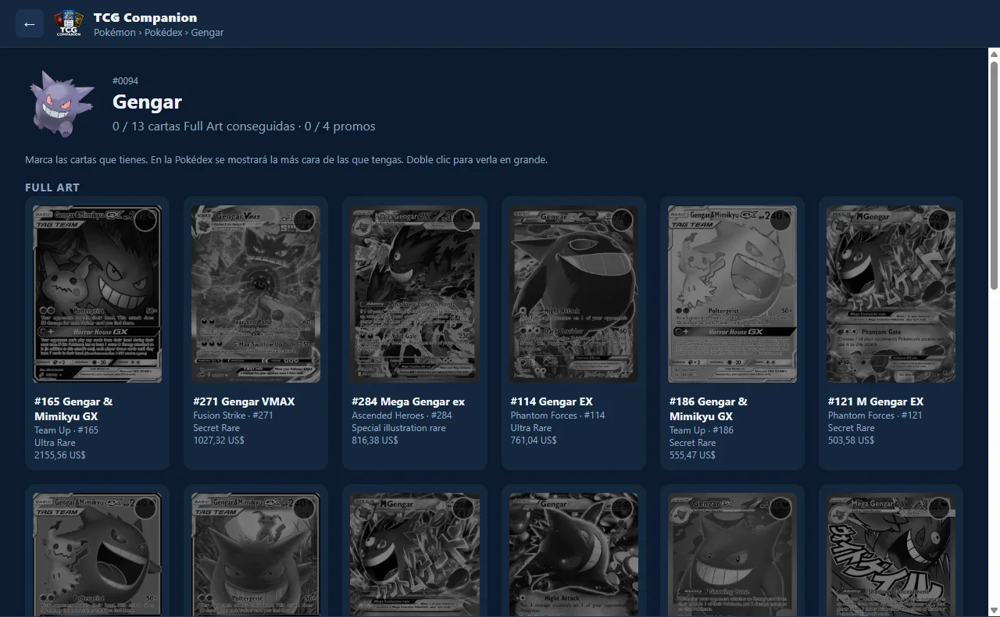
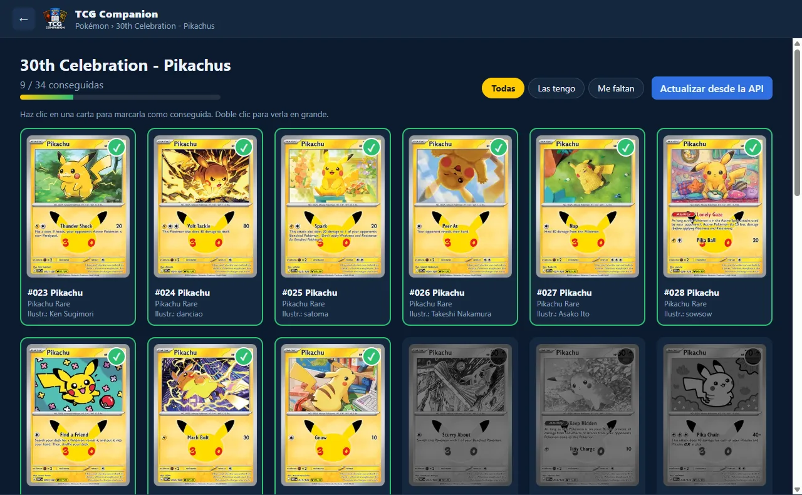

<p align="center">
  
</p>

<h1 align="center">TCG Companion</h1>

<p align="center">
  App de escritorio para llevar el control de tus colecciones de cartas TCG.<br />
  Marca las cartas que tienes, mira cuánto te falta para completar cada colección y arma tu Pokédex de Full Arts.
</p>

<p align="center">
  
  
  
  
</p>

---



## Funciones

| TCG | Estado |
|---|---|
| Pokémon | ✅ Disponible |
| Magic: The Gathering | 🔜 Próximamente |
| One Piece | 🔜 Próximamente |

### Pokémon

- **Pokédex de Full Arts.** Están los 1025 Pokémon de la Pokédex nacional.
  - Los que no tienen ninguna carta Full Art salen en gris.
  - Al entrar en un Pokémon ves todas sus cartas Full Art con su **precio de mercado**, ordenadas de más cara a más barata, y marcas las que tienes.
  - En la Pokédex, la imagen del Pokémon se cambia por **la carta más cara que tienes** de él.
  - Debajo de las Full Art hay una sección **Promos** con todas las promos de ese Pokémon. TCGdex no indica cuáles son Full Art, así que aparecen todas.
  - Tiene buscador por nombre o número y filtros *Todos / Conseguidos / Me faltan*.
- **Sets.** Por ahora está *30th Celebration - Pikachus*, con los 34 Pikachu del set 30th Celebration.
- **Progreso.** Cada colección muestra cuántas cartas tienes y el porcentaje completado.
- **Funciona sin conexión.** Las cartas se descargan una vez y quedan guardadas en tu equipo. El botón *Actualizar desde la API* vuelve a descargarlas cuando salen cartas nuevas, y **no borra lo que marcaste**.

## Capturas

| Elegir TCG | Colecciones de Pokémon |
|---|---|
|  |  |

| Cartas Full Art de un Pokémon | Set 30th Celebration - Pikachus |
|---|---|
|  |  |

## Instalación

Necesitas [Node.js](https://nodejs.org/) 20 o superior.

```bash
git clone <url-del-repositorio>
cd TCGCompanion
npm install
npm start
```

### Uso

- **Clic** en una carta: la marca como conseguida. Otro clic la desmarca.
- **Doble clic** en una carta: la muestra en grande.
- La ruta de la base de datos aparece en el pie de la app. Si haces clic en ella, se abre la carpeta en el explorador.

### Crear el instalador de Windows

```bash
npm run dist
```

Genera un instalador `.exe` en `dist/`.

## Stack

| Parte | Tecnología |
|---|---|
| App de escritorio | [Electron](https://www.electronjs.org/) |
| Interfaz | HTML, CSS y JavaScript sin frameworks |
| Base de datos | SQLite mediante [sql.js](https://sql.js.org/) (WebAssembly, no hay que compilar nada) |
| Datos de cartas y precios | [TCGdex](https://tcgdex.dev) (API gratuita, sin API key) |
| Pokédex, nombres y sprites | [PokeAPI](https://pokeapi.co/) |
| Iconos | `sharp` + `png-to-ico` |
| Instalador | `electron-builder` |

## Estructura del proyecto

```
├── main.js                 Proceso principal de Electron (ventana + IPC)
├── preload.js              Puente seguro entre la interfaz y el proceso principal
├── renderer/               Interfaz (index.html, styles.css, app.js)
├── src/
│   ├── db.js               Esquema y consultas SQLite
│   ├── pokemon-api.js      Cliente de TCGdex y PokeAPI
│   └── pokedex-sync.js     Sincronización de la Pokédex y precios
├── assets/                 Icono de la app e imágenes de cada TCG
├── scripts/make-icons.js   Genera icon.png / icon.ico desde el logo
└── docs/                   Logo y capturas del README
```

## Datos

Todo se guarda en un fichero SQLite en `%APPDATA%\tcg-companion\tcg-companion.sqlite`. Puedes abrirlo con [DBeaver](https://dbeaver.io/) creando una conexión de tipo *SQLite*. Si vas a editar datos desde DBeaver, hazlo con la app cerrada, porque la app reescribe el fichero cada vez que marcas una carta.

| Tabla | Contenido |
|---|---|
| `collections` | Colecciones disponibles (TCG, set, filtro por nombre) |
| `cards` | Cartas de cada set descargadas de la API (incluye el JSON completo) |
| `owned_cards` | Cartas que tienes (`card_id`, `quantity`) |
| `pokedex` | Especies de la Pokédex nacional |
| `fullart_cards` | Cartas Full Art y promos de cada Pokémon (`dex_id`, `kind`) |
| `card_prices` | Precio de mercado (TCGplayer en USD, o Cardmarket en EUR si no hay) |

### Qué cuenta como "Full Art"

TCGdex no tiene una categoría "Full Art", así que se deduce por la rareza. La lista está en `FULL_ART_RARITIES` (`src/pokemon-api.js`) y es fácil de ajustar:

> Ultra Rare · Illustration rare · Special illustration rare · Hyper rare · Mega Hyper Rare · Secret Rare · Shiny Ultra Rare · Shiny rare V · Shiny rare VMAX · Black White Rare

Las cartas de TCG Pocket, de entrenadores y de energías no se incluyen. Los precios se descargan al abrir un Pokémon y se refrescan cada 7 días.

### Añadir colecciones

Para añadir otro set de Pokémon basta con una entrada en `SEED_COLLECTIONS` (`src/db.js`), con el id del set en TCGdex y, si quieres, un filtro por nombre:

```js
{ id: 'pkm-30th-pikachus', tcg: 'pokemon', name: '30th Celebration - Pikachus', set_id: '30th', name_filter: 'Pikachu', sort_order: 1 }
```

## Limitaciones conocidas

- Las cartas muy nuevas pueden tardar unas semanas en llegar a TCGdex. Por ejemplo, la promo MEP 101 Nidorina todavía no está.
- Algunas promos no tienen imagen en la API. Aparecen como un recuadro con el texto "Sin imagen" y se pueden marcar igualmente.
- Si una carta no tiene precio en TCGplayer se usa el de Cardmarket. En ese caso, comparar cuál es la más cara es aproximado, porque mezcla USD y EUR.

## Roadmap

- [ ] Magic: The Gathering
- [ ] One Piece Card Game
- [ ] Más sets de Pokémon
- [ ] Añadir a mano cartas que todavía no están en la API

## Créditos

Los datos de cartas provienen de [TCGdex](https://tcgdex.dev) y los de la Pokédex de [PokeAPI](https://pokeapi.co/).
Pokémon y sus nombres son marcas de Nintendo, Creatures Inc. y GAME FREAK inc. Magic: The Gathering es marca de Wizards of the Coast. One Piece es marca de Eiichiro Oda / Shueisha / Bandai. Este proyecto no está afiliado a ninguno de ellos.

## Licencia

[MIT](LICENSE)
